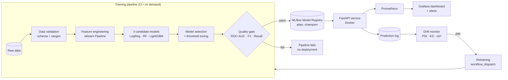

# Churn MLOps — End-to-end ML platform for customer churn prediction


A production-style MLOps project: a churn model is **trained, tracked, validated, versioned,
served, monitored and retrained automatically**. It covers the whole lifecycle, not only training
the model.

**Use case:** a telecom operator wants to know which customers are about to cancel their
subscription so the retention team can contact them first.
Dataset: [IBM Telco Customer Churn](https://github.com/IBM/telco-customer-churn-on-icp4d) (7,043 customers, 26.5 % churn).

---

## Architecture



## Features

| Area | What it does |
|---|---|
| **Data validation** | Data contract (allowed categories, numeric ranges, churn-rate sanity check). The pipeline stops on bad data. |
| **Reproducible training** | A single scikit-learn `Pipeline` (feature engineering, preprocessing, model), so training and serving cannot diverge. Everything is driven by `configs/config.yaml`. |
| **Experiment tracking** | Every candidate is a nested MLflow run with its params, metrics, plots (ROC, confusion matrix) and feature importance. |
| **Model selection** | Best model chosen on validation ROC-AUC. The decision threshold is tuned for F1 instead of the default 0.5, because the classes are imbalanced. |
| **Quality gate** | The model is promoted only if test ROC-AUC ≥ 0.80, F1 ≥ 0.58 and recall ≥ 0.65. Otherwise CI fails. |
| **Model registry** | Registered in MLflow with a `champion` alias and the threshold stored as a version tag. |
| **Serving** | FastAPI with strict Pydantic validation, single and batch prediction, hot model reload, health check, OpenAPI docs. |
| **Observability** | Prometheus metrics (requests, latency histograms, prediction distribution, churn rate, drift share), a provisioned Grafana dashboard and 5 alert rules. |
| **Drift monitoring** | Population Stability Index plus KS / chi² tests on every feature and on the predictions, with an HTML/JSON report and a background check inside the API. |
| **CI/CD** | GitHub Actions runs lint, tests (≥ 80 % coverage), training with the quality gate, Docker build, a container smoke test, then pushes to GHCR tagged with the model version. Retraining runs weekly. |
| **Containers** | Multi-stage Dockerfile (light non-root `serve` image, `train` image) and docker-compose for the full stack. |

## Results (test set, 1,409 customers never seen during selection)

| Model | Validation ROC-AUC |
|---|---|
| **Logistic Regression** (selected) | **0.852** |
| Random Forest | 0.849 |
| LightGBM | 0.848 |

| ROC-AUC | PR-AUC | F1 | Precision | Recall | Threshold |
|---|---|---|---|---|---|
| 0.846 | 0.655 | 0.625 | 0.583 | 0.674 | 0.64 |

The model catches **2 out of 3 churners**. Logistic regression wins over the tree ensembles,
which is common on small, mostly categorical tabular data. It is also the easiest model to
explain to a business team.

## Quick start

```bash
# 1. Install
python -m venv .venv && source .venv/bin/activate
make install

# 2. Train (downloads data, trains 3 models, applies the quality gate, registers the champion)
make train

# 3. Serve
make serve                      # → http://localhost:8000/docs

# 4. In another terminal: send traffic, then simulate a drift
make simulate
make simulate-drift
make drift                      # → reports/drift_report.html

# 5. Explore experiments
make mlflow-ui                  # → http://localhost:5000
```

### Full stack with Docker

```bash
make docker-up        # trains locally, then starts MLflow · API · Prometheus · Grafana
make simulate         # generate traffic
make docker-train     # retrain inside Docker against the MLflow server + hot reload the API
```

| Service | URL |
|---|---|
| API docs | http://localhost:8000/docs |
| MLflow | http://localhost:5000 |
| Prometheus | http://localhost:9090 |
| Grafana (admin/admin) | http://localhost:3000 → dashboard *Churn MLOps — Production* |

Set `MODEL_SOURCE=mlflow` to make the API load `models:/churn-classifier@champion` from the
registry instead of the model file baked into the image.

## API

```bash
curl -X POST localhost:8000/predict -H "Content-Type: application/json" \
     -d @tests/fixtures/customer.json
```
```json
{"churn_probability": 0.9295, "will_churn": true, "risk_level": "high",
 "model_version": "1", "threshold": 0.64}
```

| Method | Endpoint | Description |
|---|---|---|
| POST | `/predict` | Score one customer |
| POST | `/predict/batch` | Score up to 1,000 customers |
| GET | `/model/info` | Served model, version, threshold, test metrics |
| POST | `/model/reload` | Hot-reload the champion model |
| GET | `/monitoring/drift` | Drift on the last N predictions |
| GET | `/health` · `/metrics` | Health check · Prometheus metrics |

## Drift monitoring

`scripts/simulate_traffic.py --drift` simulates a realistic shift: a 35 % price increase and a
wave of new month-to-month customers. The monitor flags `tenure`, `MonthlyCharges`,
`TotalCharges`, `Contract`, `PaymentMethod` **and** a shift in the prediction distribution, and
it recommends retraining.

| PSI | Interpretation |
|---|---|
| < 0.10 | stable |
| 0.10 – 0.20 | to watch |
| > 0.20 | significant drift |

A feature counts as drifted when its PSI is above the threshold **and** its statistical test is
significant, which avoids false alarms on large samples. Retraining is recommended when more
than 30 % of the features drift or when the predictions drift.

## Project structure

```
├── configs/config.yaml          # single source of truth (features, models, thresholds)
├── src/churn/
│   ├── data.py                  # ingestion, cleaning, stratified split
│   ├── validation.py            # data contract
│   ├── features.py              # feature engineering + sklearn pipelines
│   ├── evaluate.py              # metrics, threshold tuning, quality gate
│   ├── train.py                 # training pipeline + MLflow + registry
│   ├── api/                     # FastAPI app, schemas, model store, Prometheus metrics
│   └── monitoring/drift.py      # PSI / KS / chi² drift detection + HTML report
├── scripts/                     # data download, traffic simulator
├── tests/                       # 26 unit + integration tests (synthetic data, 89 % coverage)
├── docker/Dockerfile            # multi-stage: serve / train
├── docker-compose.yml           # MLflow · API · Prometheus · Grafana
├── monitoring/                  # Prometheus config + alert rules, Grafana dashboard
└── .github/workflows/ci.yml     # lint → test → train + gate → build → smoke test → push
```

## Tech stack

Python 3.12 · scikit-learn · LightGBM · pandas · MLflow (tracking + registry) · FastAPI ·
Pydantic · Prometheus · Grafana · Docker · docker-compose · GitHub Actions · pytest · Ruff

## Possible next steps

- Kubernetes deployment (Helm chart) with canary releases between champion and challenger
- Feature store (Feast) and data versioning (DVC)
- Model explanations per prediction (SHAP) returned by the API
- Automatic retraining triggered by the drift alert (Alertmanager webhook → `workflow_dispatch`)
